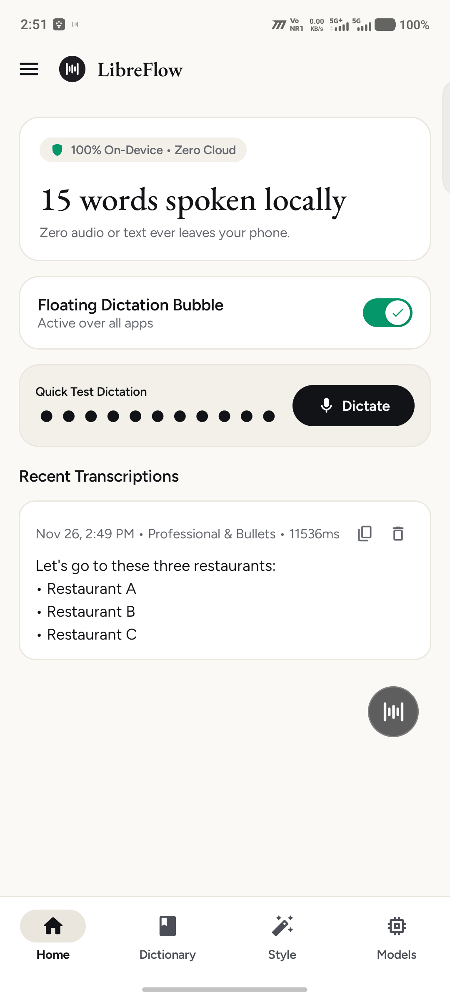
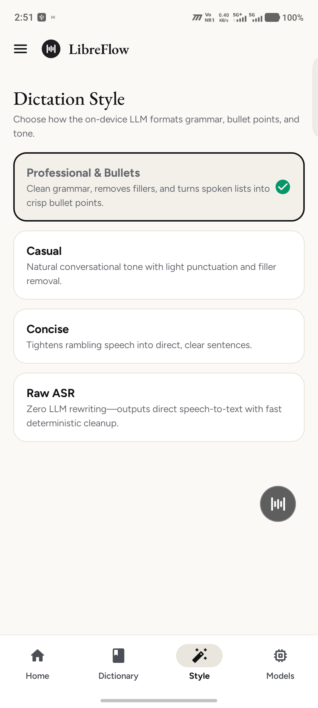
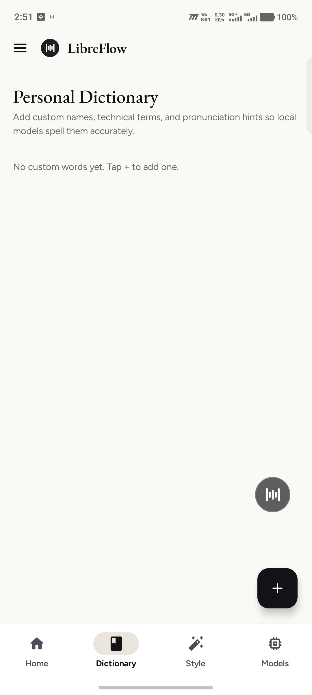
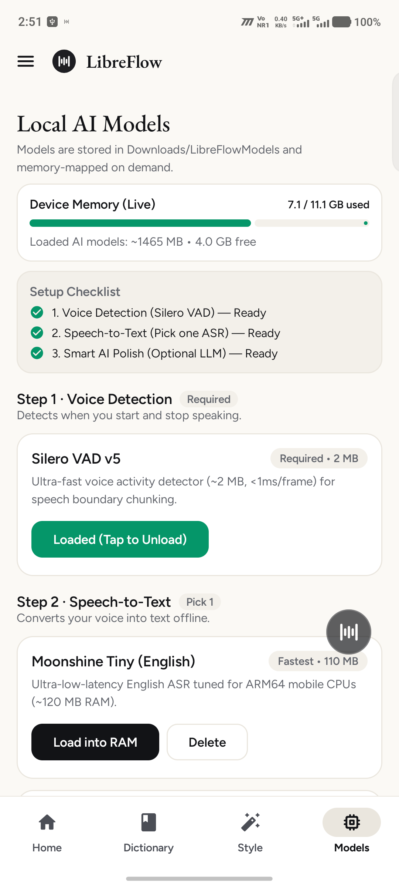
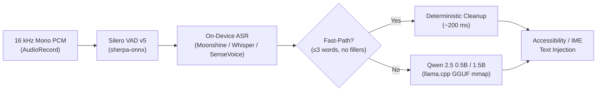

<div align="center">

# LibreFlow

**100% On-Device, Zero-Cloud AI Voice Dictation for Android**

[-3DDC84?logo=android&logoColor=white)](https://developer.android.com)
[](https://kotlinlang.org)
[](LICENSE)

Speak naturally anywhere on your phone. LibreFlow captures audio, detects speech boundaries, transcribes, cleans up grammar & bullet points, and injects text into any app **entirely offline on your device**.

No cloud APIs. No subscriptions. No telemetry. No censorship.

</div>

---

## Screenshots

| Home & History | Dictation Styles | Personal Dictionary | Local AI Models |
| :---: | :---: | :---: | :---: |
|  |  |  |  |

---

## Key Features

- **100% Local Inference Pipeline**: All AI models (VAD, ASR, and SLM) run natively on-device using `sherpa-onnx` and `llama.cpp` (`arm64-v8a`).
- **Floating Dictation Bubble**: A smooth, draggable 120Hz pill overlay (`TYPE_APPLICATION_OVERLAY`) with magnetic edge-snapping, adjustable size (`0.7x–1.4x`), and adjustable opacity (`20%–100%`).
- **Universal Text Injection**: Works inside WhatsApp, Chrome, Slack, Notes, and more via `FlowAccessibilityService` (with `NodeIdentityHash` focus tracking and smart placeholder overwriting) plus a companion **Voice Keyboard IME** fallback.
- **Context-Aware AI Polish**: Removes filler words (*"um"*, *"uh"*, *"om"*), fixes grammar, condenses rambling speech (**Concise**), and structures spoken lists into crisp bullet points (**Professional & Bullets**).
- **Fast-Path Mode (~200 ms)**: Short utterances (≤ 3 words without fillers) bypass the LLM automatically for near-instant injection.
- **Zero-Bloat APK & Live RAM Meter**: Models are never bundled in the APK—download only what you need into `Downloads/LibreFlowModels/` and monitor live device memory usage as models load/unload.
- **Impartial Transcription**: Zero moral policing or asterisk masking; if an LLM refusal is ever detected, LibreFlow falls back to the verbatim ASR output.

---

## End-to-End Inference Pipeline



1. **Audio Capture (`AudioCaptureManager`)**: Records 16 kHz 16-bit mono PCM with `VOICE_RECOGNITION` tuning and pushes smoothed RMS amplitudes via a lock-free provider directly into Compose `DrawScope` for zero-recomposition 120Hz waveform animations.
2. **Voice Activity Detection (`SileroVadEngine`)**: Segments speech boundaries at 32 ms frames (~2 MB ONNX model, <1 ms/frame).
3. **Speech-to-Text (`SherpaAsrEngine`)**:
   - **Moonshine Tiny (English)** — ~110 MB download, ~150 MB RAM (fastest)
   - **Whisper Base (English)** — ~145 MB download, ~200 MB RAM (balanced accuracy)
   - **SenseVoice Small (Multilingual)** — ~230 MB download, ~280 MB RAM (high-accuracy multilingual + ITN)
4. **Smart AI Polish (`LlamaSlmEngine` + `FastPathEngine`)**:
   - **Qwen 2.5 0.5B Instruct (`Q4_K_M`)** — ~398 MB download, ~550 MB RAM (recommended for 6–8 GB devices)
   - **Qwen 2.5 1.5B Instruct (`Q4_K_M`)** — ~980 MB download, ~1.25 GB RAM (recommended for 12 GB+ devices)

---

## Installation (Android 9+)

1. Download the latest `LibreFlow-v*-arm64.apk` from the [**Releases**](../../releases) page.
2. Install the APK on your `arm64-v8a` Android phone.
3. Open **LibreFlow** → **Models** tab:
   - **Step 1 (Required)**: Download & load **Silero VAD v5**.
   - **Step 2 (Pick 1)**: Download & load **Moonshine Tiny**, **Whisper Base**, or **SenseVoice Small**.
   - **Step 3 (Optional)**: Download & load **Qwen 2.5 0.5B** or **1.5B** for smart formatting & bullet points.
4. On the **Home** tab, grant **Microphone**, enable **Floating Dictation Bubble**, and enable **LibreFlow Text Injector** in Android Accessibility settings.

---

## Building from Source

### Prerequisites
- **JDK 17+** (tested with Java 21)
- **Android SDK** (`compileSdk = 35`, `minSdk = 28`)

### Build Commands
```bash
git clone https://github.com/notsanbid/LibreFlow.git
cd LibreFlow

# Run unit tests
./gradlew testDebugUnitTest

# Build R8-minified arm64-v8a release APK
./gradlew assembleRelease
```
*(Note: Gradle automatically fetches `sherpa-onnx-2.0.3.aar` into `app/libs/` if not already present.)*

---

## Automated CI & Releases

- **CI (`.github/workflows/ci.yml`)**: Automatically runs unit tests and builds debug/release APKs on every push or pull request to `main`.
- **Releases (`.github/workflows/release.yml`)**: Pushing a version tag (`git tag v1.0.0 && git push origin v1.0.0`) automatically builds the `arm64-v8a` release APK and publishes it to GitHub Releases.

---

## License

Released under the [MIT License](LICENSE).
